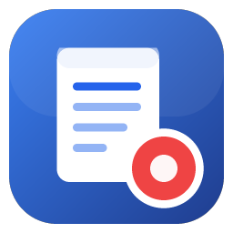
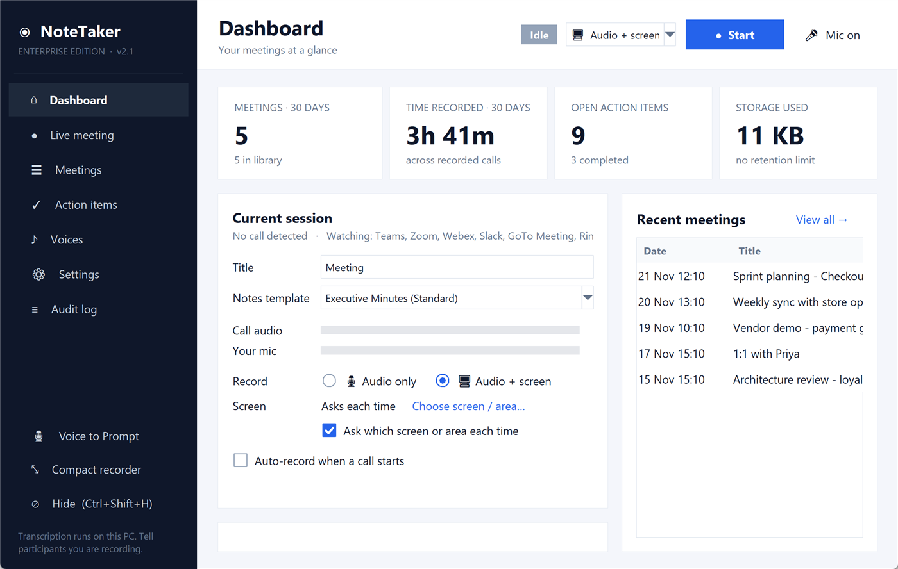
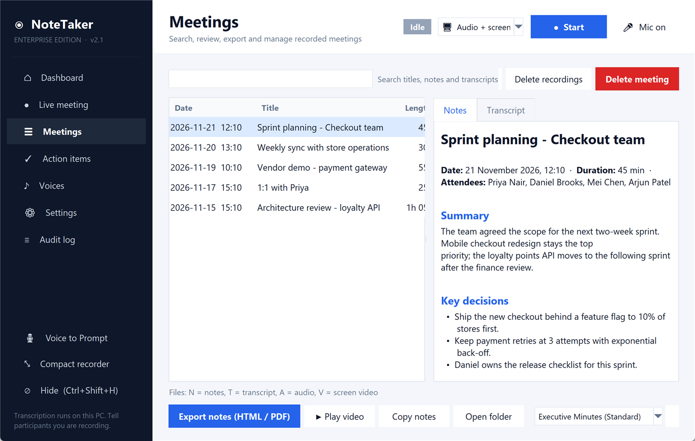
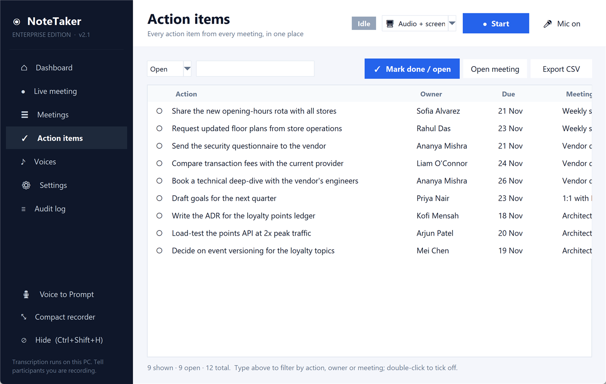
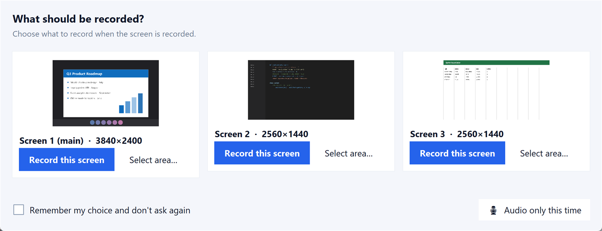
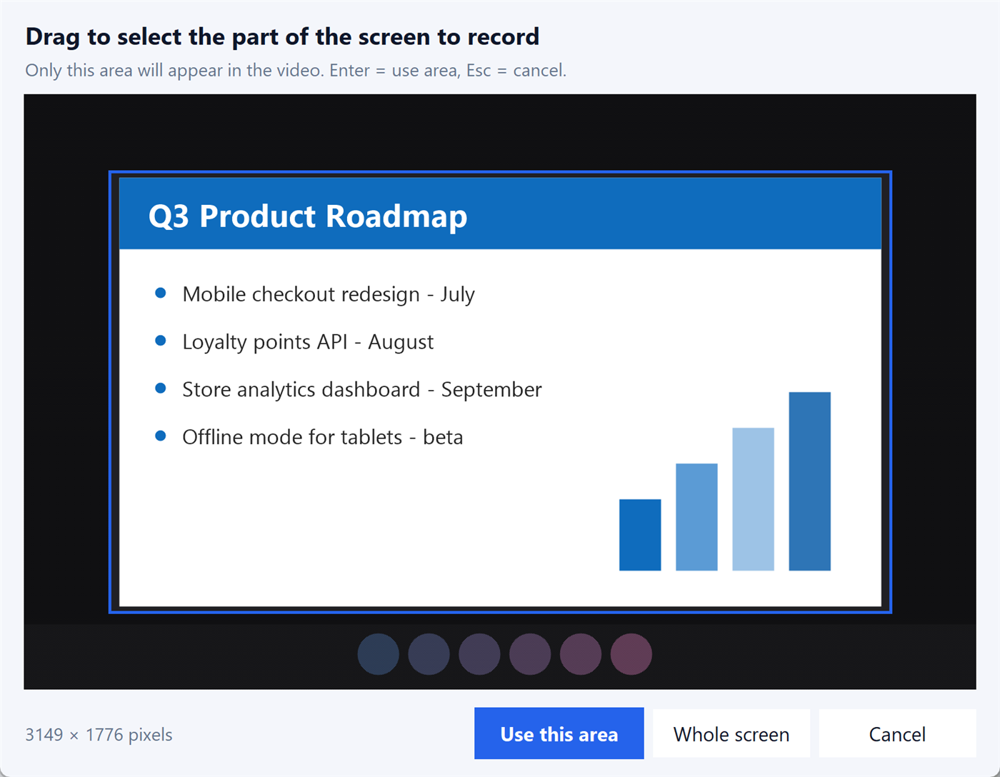
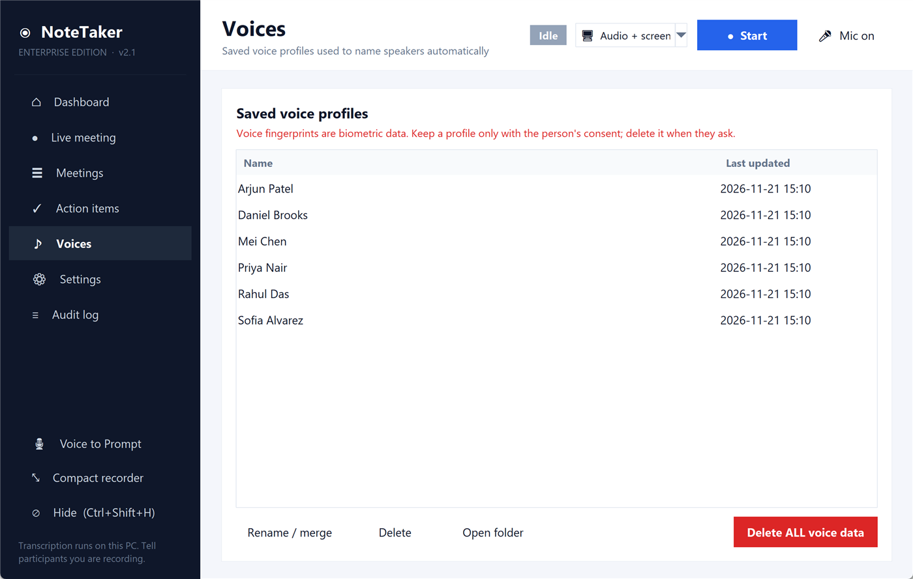
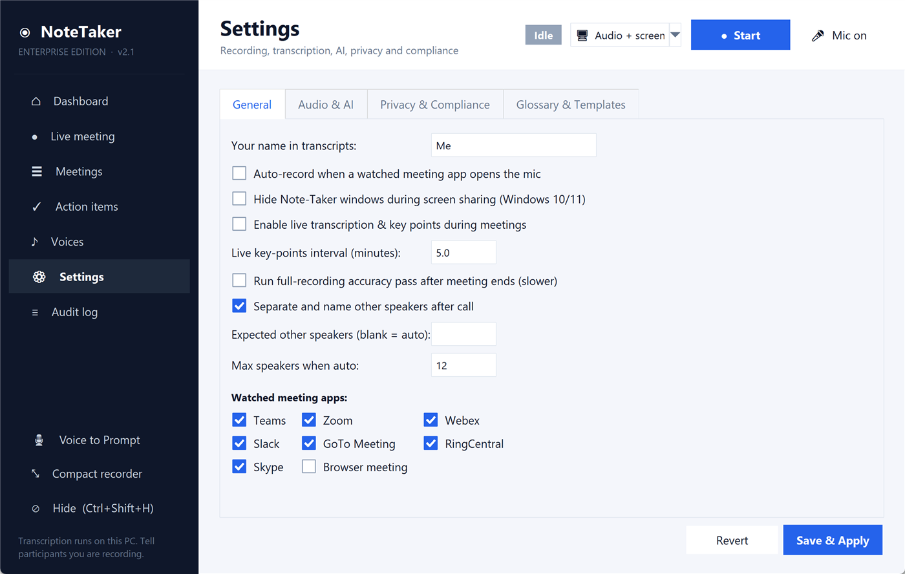
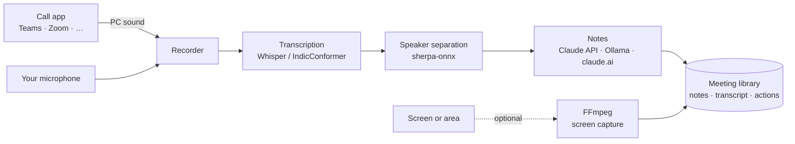

# Meeting Note-Taker

**Record any Windows call, get a transcript with speaker names, and turn it into meeting notes and action items, with transcription done on your own PC.**

[Quick start](#quick-start) · [Features](#features) · [User guide](docs/USER_GUIDE.md) · [Troubleshooting](docs/TROUBLESHOOTING.md) · [Changelog](CHANGELOG.md)

<picture>
  <source media="(prefers-color-scheme: dark)" srcset="docs/images/dashboard_dark.png">
  
</picture>

---

## Why Meeting Note-Taker?

- **Works with every meeting app.** It records the PC's sound and your microphone, so Teams, Zoom, Webex, Slack, Google Meet in a browser and any other call app all work. No bot joins the call.
- **Transcription stays on your PC.** It uses [faster-whisper](https://github.com/SYSTRAN/faster-whisper) and, for Odia and other Indian languages, [AI4Bharat IndicConformer](https://huggingface.co/ai4bharat). Audio is never uploaded.
- **Names the speakers.** Voices are separated with [sherpa-onnx](https://github.com/k2-fsa/sherpa-onnx). You name each voice once and later meetings recognise it.
- **Writes the notes for you.** It uses the Claude API, a local [Ollama](https://ollama.com) model, or a prompt copied to your clipboard for claude.ai. Notes include a summary, decisions, risks and an action-item table.

## Features

| | |
|---|---|
| 🎙 **Auto-record calls** | Starts when Teams, Zoom or another watched app uses the microphone, and stops when the call ends. |
| 🖥 **Audio + screen** | Optional screen recording: a whole screen or a selected area, in sync with the audio, saved as `meeting_video.mp4`. |
| 🗣 **Speaker names** | Separates the voices and asks "Who was speaking?" once. Saved voice profiles name people automatically next time. |
| 🌏 **Indian languages** | Odia and 21 more Indian languages through IndicConformer. A language guard stops Whisper from writing Odia speech in Chinese or Korean script. |
| 📝 **Notes templates** | Executive minutes, 1:1, incident handoff and technical architecture. You can also write your own. |
| ✅ **Action-item tracker** | Collects every action item from every meeting in one list that you can filter, tick off, or export to CSV. |
| 🔎 **Meeting library** | Search titles, notes and transcripts. Export notes to HTML or PDF, play the video, or delete recordings. |
| 📅 **Outlook integration** | Names the recording after the current Outlook meeting and suggests the attendees as speaker names. |
| 🔒 **Privacy & compliance** | Automatic deletion of old recordings, an append-only audit log, a hide-from-screen-share option, and a deliberately limited clipboard. |
| 🌗 **Modern UI** | Light and dark themes, sharp on 150–200 % scaled screens, and a compact always-on-top recorder. |

## Screenshots

| Meetings: notes and transcript | Action items across all meetings |
|---|---|
|  |  |
| **Choose what to record** (multi-monitor) | **Record only part of a screen** |
|  |  |
| **Saved voice profiles** | **Settings** |
|  |  |

> All screenshots use made-up demo data.

## Quick start

**Portable: no installation, no admin rights, no Python, no NVIDIA card needed.**

1. **Download** `MeetingNoteTaker-2.2-win64.zip` (164 MB) from **[Releases](https://github.com/swainamar/MeetingNoteTaker/releases/latest)**.
2. **Extract it** to a folder of your own, for example `Documents\Meeting Note-Taker`. Right-click the ZIP and choose **Extract All**.
3. **Double-click `MeetingNoteTaker.exe`.**
4. **Keep it handy.** Right-click `MeetingNoteTaker.exe` and choose **Pin to taskbar** or **Pin to Start**. For a desktop icon, choose **Show more options → Send to → Desktop (create shortcut)**. Once pinned, it works like Word or Excel.

On first use the app downloads the speech model once (about 480 MB on a normal PC), then works offline. If Windows shows *"Windows protected your PC"*, click **More info → Run anyway**. The app is not code-signed.

The [Installation guide](docs/INSTALL.md) covers GPU acceleration, Odia/Indian languages, AI notes and running from source.

## Requirements

| | Minimum | Recommended |
|---|---|---|
| OS | Windows 10 (64-bit) | Windows 11 |
| Admin rights | Not needed | — |
| Python | Not needed (bundled) | — |
| RAM | 8 GB | 16 GB |
| GPU | Not needed (runs on the CPU) | NVIDIA GPU with the free *GPU support* add-on, for faster transcription |
| Disk | ~1 GB (app 484 MB + speech model ~480 MB) | +5 GB for Odia/Indian languages, plus recordings: audio ~230 MB/hour, video ~100–300 MB/hour |

## How it works

Each meeting is saved in its own folder under `MeetingNoteTaker/meetings/`, containing `notes.md`, `transcript.md`, the audio, `meeting.json`, and `meeting_video.mp4` if the screen was recorded.

## Documentation

- [Installation guide](docs/INSTALL.md)
- [User guide](docs/USER_GUIDE.md): recording, screen recording, speakers, notes, action items and settings
- [Troubleshooting & FAQ](docs/TROUBLESHOOTING.md)
- [Privacy & security](SECURITY.md)
- [Changelog](CHANGELOG.md)
- [Contributing](CONTRIBUTING.md)

## Privacy

Recording people can require their consent. **Always tell participants that you are recording.** Recordings, transcripts and voice profiles stay on your PC, unencrypted, so keep the folder on a BitLocker-encrypted drive. Meeting text is sent to an AI service only if you set up the Claude API or paste the prompt into claude.ai yourself. A local Ollama model keeps everything on the PC. See [SECURITY.md](SECURITY.md).

## License

[MIT](LICENSE). The third-party models and libraries keep their own licenses; see [Acknowledgements](docs/INSTALL.md#acknowledgements).
