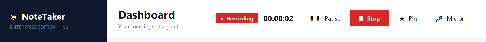
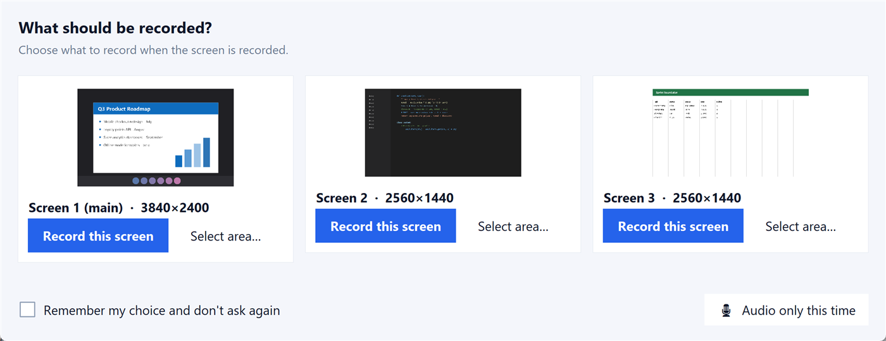
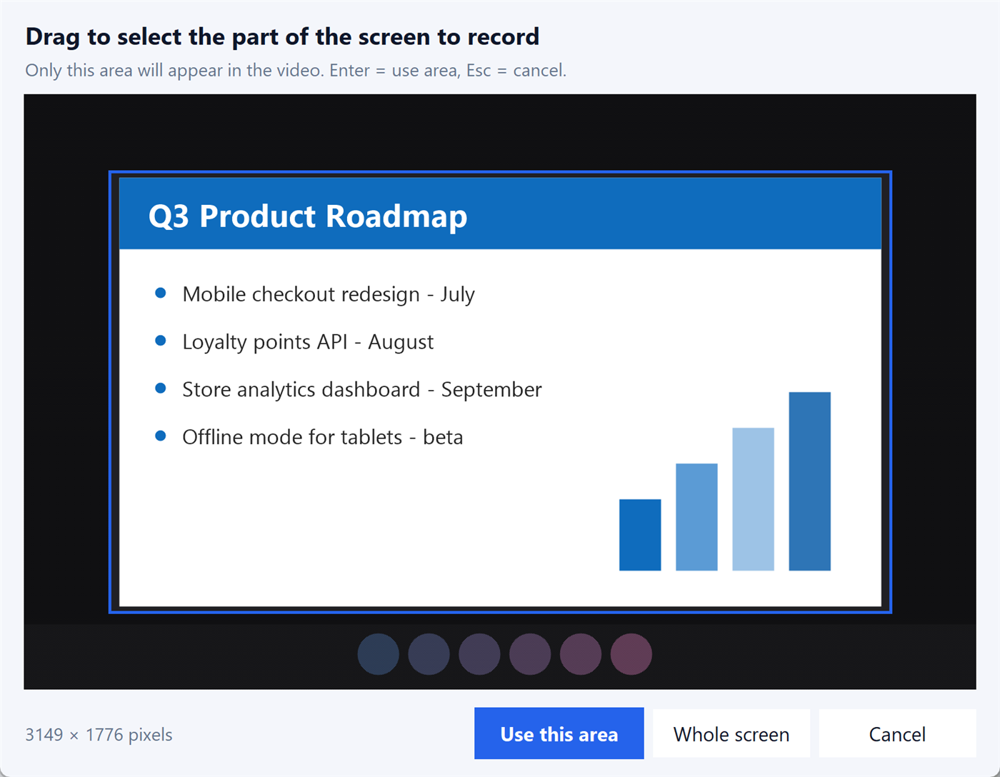
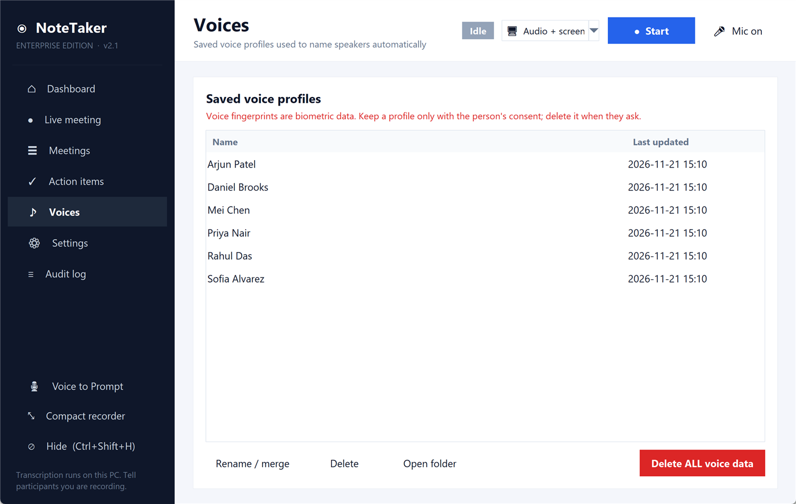
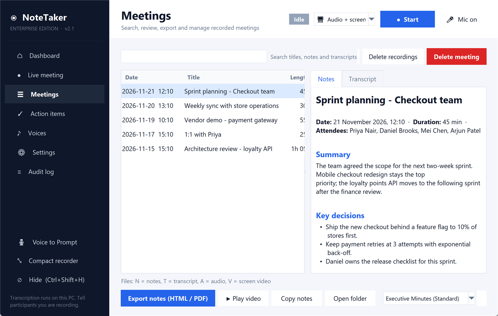
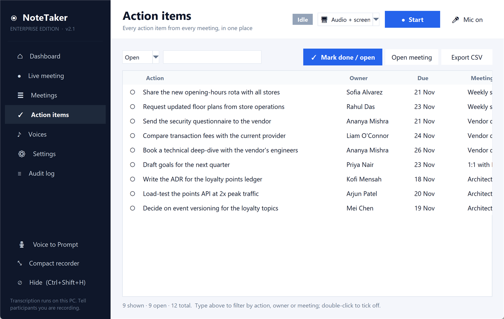

# User guide

[← Back to README](../README.md)

- [Recording a meeting](#recording-a-meeting)
- [Audio only or audio + screen](#audio-only-or-audio--screen)
- [Naming the speakers](#naming-the-speakers)
- [Meeting notes](#meeting-notes)
- [Meetings library](#meetings-library)
- [Action items](#action-items)
- [Live meeting](#live-meeting)
- [Settings](#settings)
- [Keyboard shortcuts](#keyboard-shortcuts)

---

## Recording a meeting

**Tell everyone in the call that you are recording.**

### Automatically

Tick **Auto-record when a call starts** on the Dashboard. The app watches the meeting apps ticked in **Settings → General → Watched meeting apps**: Teams, Zoom, Webex, Slack, GoTo Meeting, RingCentral, Skype, and optionally browser meetings.

- **Start:** recording starts about 3 seconds after one of these apps turns on the microphone.
- **Stop:** it stops about 8 seconds after the app releases the microphone.
- **Very short calls:** recordings under 15 seconds are discarded.

### Manually

Click **● Start** in the top bar. While recording, the top bar shows the timer and these buttons:

| Button | What it does |
|---|---|
| **❚❚ Pause / ▶ Resume** | Paused time is left out of the audio and the video. |
| **■ Stop** | Ends the recording and starts processing. |
| **★ Pin** | Bookmarks the current moment. It appears as ★ in the transcript. |
| **🎤 Mic on / 🔇 Mic off** | Records or skips your own microphone. |

**Compact recorder** (sidebar) opens a small always-on-top bar with the status, timer, level, pause, stop and pin.

## Audio only or audio + screen

Choose the **record mode** next to **● Start**, or under **Record** on the Dashboard:

- **🎙 Audio only:** produces the transcript and notes.
- **🖥 Audio + screen:** also produces `meeting_video.mp4`, with the screen and the call audio in sync.

With **Audio + screen**, the audio starts at once and a **"What should be recorded?"** window opens:

- **Record this screen:** records the whole screen. Each screen shows a live preview with its real resolution.
- **Select area…:** drag a rectangle, like the Snipping Tool, to record only that part. The pixel size is shown while you drag.

  

- **Audio only this time:** skips the video for this call.
- **Remember my choice and don't ask again:** always records this screen or area. Change it later with **Choose screen / area…** on the Dashboard, or tick **Ask which screen or area each time** again.

If nobody answers within 20 seconds, as with an auto-recorded call when you are away, the last choice is used.

Video settings are in **Settings → Audio & AI**: the default screen and the frame rate (5 fps is plenty for slides). The video is at most 1920 px wide.

> The video captures everything in the chosen area, including pop-up notifications. Windows marked "hide from screen sharing" are not captured.

## Naming the speakers

When **Separate and name other speakers after call** is on, the app finds the different voices after the call. A **"Who was speaking?"** dialog then lists each voice with a sample to play.

- **Name suggestions:** suggestions come from your saved voice profiles and, with Outlook integration, the meeting attendees.
- **Next time:** named voices are saved as profiles and recognised automatically in later meetings.
- **Same person listed twice:** give both voices the same name and they are merged.
- **Shortcuts:** **Enter** saves, **Esc** skips.

Manage profiles on the **Voices** page: rename, merge, delete, or **Delete ALL voice data**.

Voice profiles are biometric data. Keep a profile only with the person's consent.

## Meeting notes

After transcription, the notes are written with the selected **Notes template**:

| Template | Best for |
|---|---|
| Executive Minutes (Standard) | Most meetings: summary, decisions, discussion, action items, risks |
| One-on-One | 1:1s: updates, feedback, goals, follow-ups |
| Incident Handoff | Outages and on-call handovers |
| Technical Architecture | Design reviews and ADR-style decisions |

To change a template or add your own, go to **Settings → Glossary & Templates**. Add names, product terms and acronyms to the **Glossary** so the transcription spells them correctly.

## Meetings library

- **Search:** searches titles, notes and transcripts.
- **Notes / Transcript tabs:** formatted previews. Pinned moments are shown with ★.
- **Export notes (HTML / PDF):** a clean, print-ready page. Press **Ctrl+P → Save as PDF**.
- **▶ Play video:** shown when the screen was recorded.
- **Regenerate notes** with another template, or **Re-run speakers**.
- **Delete recordings:** deletes the audio and video and keeps the notes. **Delete meeting** deletes everything.

The *Files* column shows **N** notes, **T** transcript, **A** audio and **V** screen video.

## Action items

Every row of the *Action items* table in every meeting's notes is collected here.

- **Show and search:** show **Open**, **Done** or **All** items, and type to search by action, owner or meeting.
- **Tick off:** double-click an item, or select it and click **✓ Mark done / open**.
- **Open meeting** jumps to the source meeting.
- **Export CSV** saves the list for Excel or Planner.

## Live meeting

Turn on **Settings → General → Enable live transcription & key points**. The **Live meeting** page then shows the transcript as people speak, plus rolling AI key points every few minutes. These come from Ollama on your PC or the Claude API.

## Settings

| Tab | Main options |
|---|---|
| **General** | Your name in transcripts, auto-record, hide windows during screen sharing, live transcription, speaker separation, max speakers, watched apps |
| **Audio & AI** | Speaker and microphone devices, audio test, Whisper model, language or auto-detect languages, record mode, screen, area, frame rate, Claude/Ollama model |
| **Privacy & Compliance** | Delete audio after N days, delete meetings after N days, audit log, Outlook integration, start with Windows |
| **Glossary & Templates** | Custom vocabulary, notes templates |

The **Audit log** page lists every recording, export, deletion and settings change, with the time and the Windows user.

## Keyboard shortcuts

| Keys | Action |
|---|---|
| **Ctrl+Shift+H** | Hide or show all Note-Taker windows (works anywhere in Windows) |
| **Enter / Esc** | Save / skip in "Who was speaking?"; use area / cancel in the area selector |
